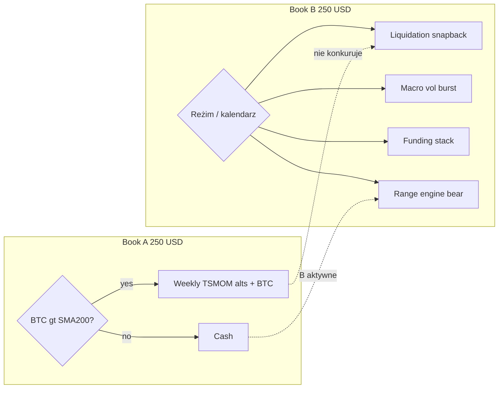

# Book B — S79+ Creative Brief ($250)

**Cel:** wymyślić **drugą** księgę, która **nie duplikuje** Book A, a **domyka lukę** do $5/dzień razem z ~$0,27/d z A.  
**Kapitał:** $250 osobno.  
**Tryb myślenia:** najpierw *jak wygrać*, potem twarde bramki researchu.

---

## Teza portfelowa

Book A jest **annuitetem hossy** (wolny, tani w opłatach, przewidywalny).  
Book B musi być **silnikiem czasu i reżimu**, gdzie rynek **płaci za błąd innych** — likwidacje, przegrzany funding, makro spike, listing frenzy — albo **płaci rentę** gdy trendu nie ma.

---

## Pięć kandydatów (od najbardziej „innego” do najbardziej ryzykownego)

### 1. **S79-LIQ — „Kaskada → odbicie”** (rekomendacja #1 do backtestu)

**Idea:** Po **skokowej serii likwidacji** (OI −X% w 1h + wick &gt; k×ATR) grać **krótkie** mean-reversion na BTC/ETH (5–15m), TP szybki, SL za ekstremum.  
**Dlaczego pod $5:** To jedyny typ zdarzenia, gdzie **+2–5% na kapitale w jeden dzień** jest realny *częściej niż raz na dekadę* — średnia rośnie od **grubych ogonów**, nie od codziennego 2%.  
**Kiedy:** Cały rok; szczególnie gdy A w cash (bear/chop).  
**Dane:** OI, liquidations (Binance/Coinglass), 1m/5m.  
**Ryzyko:** Fałszywe kaskady; trzeba twardego cooldownu.

**Hipoteza $/dzień:** 0 przy braku zdarzeń; w tygodniach vol **$1–10+** — celem researchu jest **średnia ≥ $2–3** po kosztach (ambitne, ale to jest Book B).

---

### 2. **S79-MACRO — „8 godzin roku”**

**Idea:** Handluj **tylko** okna: FOMC, CPI, US open po dużym gapie, **pierwsze 2–4h** — breakout z kompresji ATR z **podwyższoną** notional (np. 2–3× normalnej) i **hard stop dziennym** −$X.  
**Dlaczego:** Book A nie wchodzi w intraday; niska liczba tradów = niskie opłaty vs S47 scalp.  
**Dane:** Kalendarz makro + 1m BTC/ETH.  
**Ryzyko:** Overfitting do 20 dat — wymaga **wiele lat** eventów i walk-forward.

---

### 3. **S79-FUND-STACK — delta-neutral renta + ogon**

**Idea:** Gdy **funding &gt; percentyl 90** na coinie z płynnością: **short perp + long spot** (lub single-exchange hedge), zbieraj funding; **wyjdź** gdy funding normalizuje **lub** cena przebije band (ogon).  
**Dlaczego:** S56/S77 pokazały, że sam carry to centy — ale **stack** na 3–5 coinów z rotacją + **tylko poza hossą** (gdy longi są przegrzane w bear bounce) może dać **stabilniejsze** dolary niż LIQ bez codziennego tradingu.  
**Dane:** funding rate history, spot-perp basis.  
**Ryzyko:** 2022-style trend against hedge; cap na coin.

---

### 4. **S79-CHOP — „Bear range engine” (gdy A OFF)**

**Idea:** BTC &lt; SMA200 → włącz **osobny** playbook: Donchian 4h **fade** na granicach range + RSI2 na BTC tylko w **zdefiniowanym** ADX &lt; 20.  
**Dlaczego:** Book A w bear = $0; B ma **monopol** na ten czas.  
**Uwaga:** S48/S65 już odrzuciły podobne na SOL/XRP — tu **inna** skala (BTC/ETH, wyższy TF, mniej tradów).  
**Ryzyko:** Trend bear może być jednokierunkowy miesiącami — potrzebny **kill switch**.

---

### 5. **S79-LIST — „Listing / narrative burst”**

**Idea:** Reguły wejścia na **nowe perpy** / pierwsze 48h po listing (momentum + volume climax exit).  
**Dlaczego:** Najwyższa asymetria w crypto; $250 może dać **jeden** dobry tydzień = miesiąc celu.  
**Ryzyko:** Dane historyczne trudne; survivorship; execution (queue).  
**Status:** spike / paper rules najpierw, nie pełny backtest 2020.

---

## Scoring (jak wybieramy co kodować)

| Kandydat | Inność vs A | Szansa na grube dni | Dane w repo | Priorytet |
|----------|-------------|---------------------|-------------|-----------|
| S79-LIQ | ★★★★★ | ★★★★★ | częściowo (OI) | **P0** |
| S79-MACRO | ★★★★ | ★★★★ | kalendarz | P1 |
| S79-FUND-STACK | ★★★ | ★★ | funding | P1 |
| S79-CHOP | ★★★ | ★★ | tak | P2 |
| S79-LIST | ★★★★★ | ★★★★★ | słabe | P2 spike |

---

## Jak Book B **matematycznie** pomaga do $5 (scenariusz docelowy)

Nie: „$2,50/dzień każdego dnia z $250”.  
Tak: **mieszanka**

| Źródło B | Dni aktywne / rok | Przykładowy $/dzień gdy aktywne | Wkład w średnią |
|----------|-------------------|----------------------------------|-----------------|
| LIQ + MACRO | ~40–80 | $3–15 | główny motor |
| FUND-STACK | ~120 | $0,10–0,50 | podłoga |
| CHOP (A off) | ~100 | $0,50–2 | bear fill |

+ Book A: ~$0,27 × 365 ≈ **$100/rok**  
+ Book B musi dorzucić **~$1 725/rok** ≈ **$4,73/d średniej** — to wymaga **~$43/d** w **40** „super dniach” *albo* wyższej ekspozycji w tych dniach.

To jest **świadomy** model: Book B jest **venture**, nie drugi TSMOM.

---

## Protokół badawczy S79 (krótko)

1. **Ten sam kapitał $250**, te same koszty co S73 (7 bps Binance + stress 20).
2. Split: dev / val / holdout (panel 2022–2026 jeśli dane).
3. Metryki obowiązkowe: **$/dzień**, **gap do $5 (A+B)**, PF, max DD, **% dni = 0**.
4. **Gate:** Book B wchodzi do portfela tylko jeśli **korelacja dziennych zwrotów z A &lt; 0,3** i holdout **dodatni** (nawet jeśli mało dolarów — szukamy **kombinacji**).

---

## Propozycja nazwy produktowej

- **Book A:** „Sentinel Trend Rent”  
- **Book B:** „Sentinel Event Engine” (start: S79-LIQ)

---

## Jedno pytanie do Ciebie (wybór ścieżki)

Którą linię badamy **pierwszą** jako S79?

- **A)** LIQ + kaskady (P0)  
- **B)** MACRO tylko (mniej tradów, czystsze dane)  
- **C)** FUND-STACK (spokojniejsze, mniejsza szansa na $5)  
- **D)** Hybryda: **LIQ gdy vol wysoka, FUND gdy vol niska** (router Book B)

Odpowiedź literą wystarczy — potem można iść w spike/backtest bez ruszania Book A.

## Repo replay (2026-03)

| ID | validation $/dzień @ $250 | Uwaga |
|----|--------------------------:|-------|
| S79-LIQ ($15) | −0.93 | odrzucone |
| S79-LIQ lite ($5) | (patrz `s79_book_b_liq`) | mniejszy DD |
| S80-MACRO | −0.08 | odrzucone |
| S81 bear RSI2 | 0.00 | brak tradów — BTC > SMA200 w oknie |

Łącznie A+B validation: **−0.29/d** na $500 (`portfolio_two_books`).
